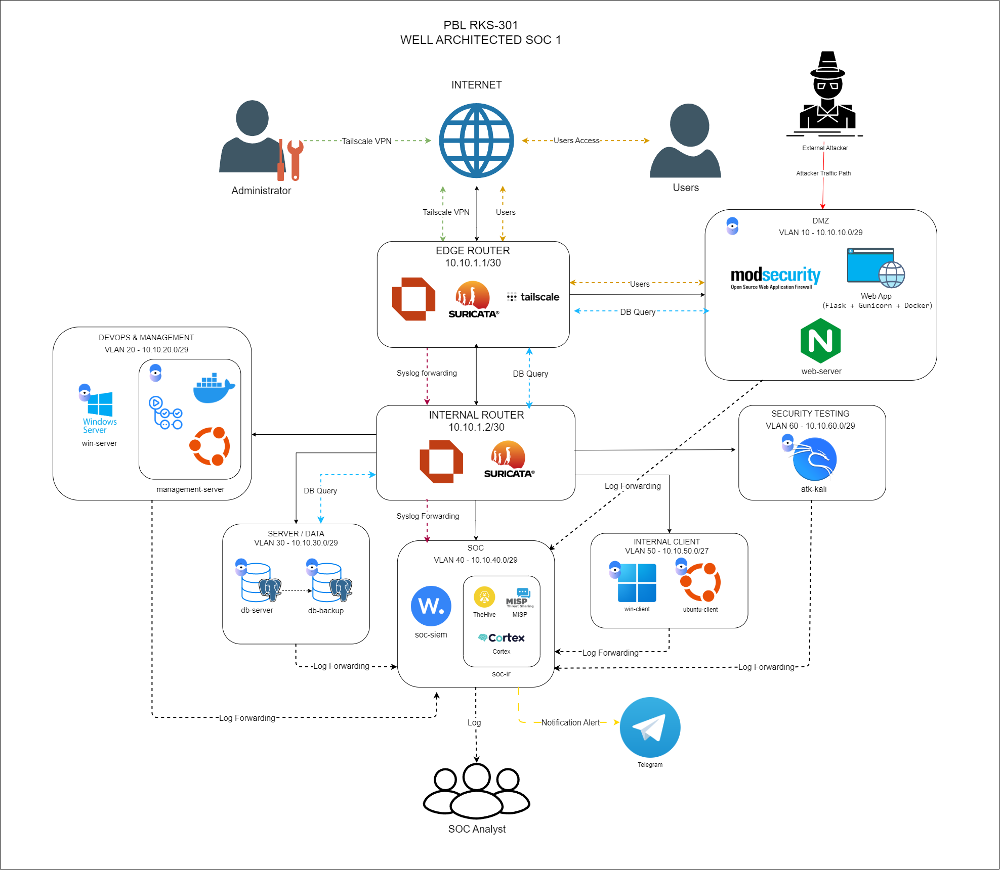

# PBL-RKS301: ITCorner.id – Secure E-Commerce IT Shop & Well-Architected SOC 1

[](.github/workflows/ci-cd.yml)
[](#arsitektur-sistem--topologi-jaringan)
[](#kontrol-keamanan--devsecops)
[-orange)](#pemetaan-infrastruktur-12-vm--vlsm-rpp-rev3)
[-success)](#ringkasan-status-fase--milestone-proyek)

Repositori resmi proyek **PBL-RKS301: ITCorner.id (Secure E-Commerce IT Shop)** pada Program Studi **Rekayasa Keamanan Siber, Politeknik Negeri Batam**.

Proyek ini bertujuan mengonstruksi platform e-commerce IT shop yang aman dan mengintegrasikannya dengan infrastruktur **Well-Architected Security Operations Center (SOC)** berbasis arsitektur *Dual-Plane* (*Data/Application Plane* & *Control/Security Operations Plane*) serta prinsip *Defense-in-Depth* berlapis.

---

## 📌 Daftar Isi
1. [Identitas & Informasi Proyek](#-identitas--informasi-proyek)
2. [Susunan Tim & Pembagian Peran](#-susunan-tim--pembagian-peran)
3. [Arsitektur Sistem & Topologi Jaringan](#-arsitektur-sistem--topologi-jaringan)
4. [Pemetaan Infrastruktur 12 VM & VLSM (RPP Rev.3)](#-pemetaan-infrastruktur-12-vm--vlsm-rpp-rev3)
5. [Tech Stack & Komponen Utama](#-tech-stack--komponen-utama)
6. [Fitur Aplikasi Web (13 Kebutuhan Fungsional)](#-fitur-aplikasi-web-13-kebutuhan-fungsional)
7. [Kontrol Keamanan & DevSecOps](#-kontrol-keamanan--devsecops)
8. [Struktur Direktori Repositori](#-struktur-direktori-repositori)
9. [Ringkasan Status Fase & Milestone Proyek](#-ringkasan-status-fase--milestone-proyek)
10. [Rincian Capaian Progress per Anggota Tim](#-rincian-capaian-progress-per-anggota-tim)
11. [Kendala Teknis & Solusi yang Telah Diterapkan](#-kendala-teknis--solusi-yang-telah-diterapkan)
12. [Panduan Instalasi & Pengujian Cepat](#-panduan-instalasi--pengujian-cepat)
13. [Peta Jalan & Agenda Selanjutnya (Roadmap M4)](#-peta-jalan--agenda-selanjutnya-roadmap-m4)

---

## 📋 Identitas & Informasi Proyek

| Parameter | Keterangan Resmi |
| :--- | :--- |
| **Kode & Judul Proyek** | **PBL-RKS301 — ITCorner.id: Secure E-Commerce IT Shop** |
| **Program Studi / Institusi** | Rekayasa Keamanan Siber (RKS), Politeknik Negeri Batam |
| **Luaran Utama** | Well-Architected SOC 1 dengan konsep Defense-in-Depth, Three-Tier Architecture, dan Dual-Plane Architecture |
| **Pengusul Proyek / Klien** | **Maidel Fani, S.Pd., M.Kom.** (KPS Rekayasa Keamanan Siber) |
| **Manajer Proyek (Manpro)** | **Antoni Haikal, S.ST, M.T.** |
| **Dosen Pengampu Terkait** | • Maidel Fani, S.Pd., M.Kom. (*SOC Essential*)<br>• Andy Triwinarko, ST., MT., Ph.D (*Internetworking*)<br>• Agus Fatulloh, S.T., M.T (*DevOps*)<br>• Muhammad Idris, S.Tr., M.Tr.Kom (*Secure Coding*) |
| **Infrastruktur Lab Host** | Laboratorium Gedung TA 10.4 Polibatam (Intel Core i9-10900K, RAM 32 GB, SSD ~300 GB free) |
| **Alokasi Waktu** | 1 Semester / 14 Minggu (Target Penyelesaian: 21 Desember 2026) |
| **Baseline Anggaran** | Rp0 (Pemanfaatan open-source software dan sarana laboratorium kampus) |

---

## 👥 Susunan Tim & Pembagian Peran

| No | NIM | Nama Anggota | Peran Konstruksi (Git Branch) | Peran Operasional SOC & Tanggung Jawab Utama |
| :-: | :---: | :--- | :--- | :--- |
| 1 | **4332511020** | **Muhammad Danish** | **Ketua Tim (PM) & Network Engineer**<br>`feat/network-config` | **SOC Lead**: Manajemen dokumen RPP, topologi 7 VLAN, OPNsense routing/firewall, Windows AD DS/DNS, dan integrasi Tailscale VPN. |
| 2 | **4332511019** | **Afry Zacky Ardiansyahri** | **DevSecOps & Security Engineer**<br>`development` | **Detection Engineer**: Dockerisasi, pipeline CI/CD GitHub Actions, skrip `deploy.sh` (auto-rollback), Nginx Reverse Proxy, ModSecurity WAF, Suricata NIDS, dan remediasi CVE. |
| 3 | **4332511023** | **Nur Arsyika Juana** | **Security Analyst**<br>`feat/threat-matrix` | **SIEM Admin & Incident Responder**: Threat Matrix 10 skenario, Wazuh SIEM v4.9.2, aturan deteksi kustom XML, integrasi alert Telegram Bot API, dan kontainer SOC-IR (TheHive, Cortex, MISP). |
| 4 | **4332501011** | **Alan Fabrian** | **Database Administrator (DBA)**<br>`feat/database-schema` | **Data Security & Recovery Specialist**: Skema ERD 8 tabel, inisialisasi PostgreSQL (`init.sql`), CHECK constraints integritas, hardening pg_hba, dan backup terenkripsi Restic REST Server (--append-only). |
| 5 | **4332511025** | **Laila Rezky** | **Web Developer (Full-Stack)**<br>`feat/web-app` | **AppSec Auditor & Tier-1 Triage**: Wireframe UI, implementasi penuh 13 fitur Flask, mitigasi OWASP Top 10 (SQLi, XSS, CSRF, IDOR), sanitasi input, validasi upload file, dan Pytest unit testing. |

---

## 🏛️ Arsitektur Sistem & Topologi Jaringan

<p align="center">
  
</p>

Sistem ITCorner.id mengimplementasikan arsitektur berorientasi keamanan tinggi dengan pemisahan bidang kerja:
- **Data & Application Plane:** Melayani interaksi pelanggan, web server di DMZ, reverse proxy, dan basis data transaksional.
- **Control & Security Operations Plane:** Jalur manajemen terisolasi untuk CI/CD Runner, Active Directory, Wazuh SIEM, serta SOC-IR Tooling.
- **Defense-in-Depth Layering:**
  1. *Perimeter Network:* Edge Router OPNsense (10.10.1.1) + Tailscale VPN + Suricata External NIDS/IPS.
  2. *Internal Firewall:* Internal Router OPNsense (10.10.1.2) dengan prinsip *Least Privilege* (11 rule matrix, default-deny all).
  3. *Web Application Firewall (WAF):* ModSecurity v3 + OWASP Core Rule Set (CRS 3.3.5) pasca-terminasi TLS pada Nginx (10.10.10.2).
  4. *Application Layer:* Parameterized Query, PBKDF2-SHA256, Anti-CSRF token, session cookie hardening (`HttpOnly`, `SameSite=Lax`), dan validasi file upload (magic bytes).
  5. *Database Layer:* CHECK constraints, pg_hba whitelist IP tunggal Web Server, dan backup berkala terenkripsi Restic.
  6. *Visibility & Response Layer:* Wazuh SIEM Agent di seluruh host mengalirkan log ke Wazuh Manager (10.10.40.2), integrasi instan ke Telegram Bot, serta eskalasi tiket ke TheHive/Cortex/MISP.

---

## 🌐 Pemetaan Infrastruktur 12 VM & VLSM (RPP Rev.3)

Topologi telah diselaraskan dengan **RPP Revisi 3 (8 November 2026)** untuk total **12 Virtual Machines**:

| Zona Jaringan / VLAN | Subnet / CIDR | Gateway | Virtual Machine & IP Address | Peran & Layanan Utama |
| :--- | :--- | :--- | :--- | :--- |
| **Transit Network** | `10.10.1.0/30` | - | • **Edge Router:** `10.10.1.1`<br>• **Internal Router:** `10.10.1.2` | Inter-router link, OPNsense routing, NAT WAN, dan Suricata Inspection |
| **VLAN 10 — DMZ** | `10.10.10.0/29` | `10.10.10.1` | • **Web/App Server:** `10.10.10.2` | Nginx Reverse Proxy (HTTPS 443), ModSecurity WAF, Flask Gunicorn (Port 5000), Wazuh Agent |
| **VLAN 20 — DevOps & Mgmt** | `10.10.20.0/29` | `10.10.20.1` | • **Management Server:** `10.10.20.2`<br>• **Windows Server AD DS:** `10.10.20.3` | Self-Hosted GitHub Actions Runner, Docker Daemon, Ansible/SSH Deployment, Active Directory & Unbound DNS |
| **VLAN 30 — Server / Data** | `10.10.30.0/29` | `10.10.30.1` | • **Database Server:** `10.10.30.2`<br>• **Backup Server:** `10.10.30.3` | PostgreSQL 15 (Port 5432 - private), Restic REST Server terenkripsi (`--append-only` TCP 8000) |
| **VLAN 40 — SOC Zone** | `10.10.40.0/29` | `10.10.40.1` | • **Wazuh SIEM Server:** `10.10.40.2`<br>• **SOC-IR Server:** `10.10.40.3` | Wazuh Manager, Indexer, Dashboard (TCP 443/1514/1515), Telegram Alerting, Docker TheHive/Cortex/MISP |
| **VLAN 50 — Internal Client** | `10.10.50.0/27` | `10.10.50.1` | • **Windows 11 Client:** `10.10.50.10`<br>• **Ubuntu Desktop:** `10.10.50.20` | Domain Member Workstation, simulasi akses internal, Sysmon & Wazuh Endpoint Monitoring |
| **VLAN 60 — Security Testing** | `10.10.60.0/30` | `10.10.60.1` | • **Kali Linux:** `10.10.60.2` | Pengujian penetrasi terkontrol, simulasi serangan Nmap, Hydra brute-force, dan uji WAF (`test_waf_attacks.sh`) |
| **Jalur VPN Administrasi** | `100.64.0.0/10` | - | • **Tailscale Subnet Router** via Edge Router (`10.10.1.1`) | Akses aman jarak jauh khusus admin menuju subnet manajemen tanpa mengekspos port ke publik |

### Strategi Eksekusi pada Host PC RAM 32 GB
Untuk mengatasi keterbatasan RAM host (32 GB) terhadap kebutuhan total 12 VM (36 GB), diimplementasikan **4 Profil Eksekusi Bergantian**:
- **Profil A (Dev / CI-CD) [~13 GB]:** Router + Web/App + Management Runner + Database.
- **Profil B (Monitoring & Test) [~23 GB]:** Router + Web/App + Database + Wazuh SIEM + Kali Linux.
- **Profil C (Incident Response & Demo) [~27 GB]:** Router + Web/App + Database + Wazuh SIEM + SOC-IR (TheHive/Cortex/MISP).
- **Profil D (Data Backup & Maintenance) [~11 GB]:** Router + Database + Backup Server (Restic).

---

## 🛠️ Tech Stack & Komponen Utama

- **Aplikasi Web Backend:** Python 3.10, Flask 3.0+, Gunicorn WSGI Server, Werkzeug, psycopg2-binary.
- **Frontend:** HTML5, Jinja2 Templates, Tailwind CSS / Vanilla CSS responsif, JavaScript modular.
- **Basis Data:** PostgreSQL 15-Alpine (Relasional 8 tabel dengan CHECK constraint & foreign keys).
- **Kontainerisasi & CI/CD:** Docker, Docker Compose, GitHub Actions Runner, Gitleaks, Bandit SAST, pip-audit (SCA), Pytest, Trivy Container Scanner.
- **Web Server & Reverse Proxy:** Nginx 1.24+ (TLS 1.3, HSTS, secure headers, rate limiting, IP whitelist `/admin`).
- **WAF & NIDS/IPS:** ModSecurity v3 + OWASP Core Rule Set (CRS 3.3.5), Suricata NIDS/IPS (JSON EVE alerts).
- **Monitoring & SOC:** Wazuh SIEM v4.9.2, TheHive 4, Cortex 3, MISP, Telegram Bot API.
- **Cadangan Data:** Restic Backup terenkripsi AES-256 + REST Server mode `--append-only`.
- **Sistem Operasi & Jaringan:** Ubuntu Server 22.04 LTS, Windows Server 2022 Datacenter, Windows 11 Enterprise, Kali Linux, OPNsense 24.x.

---

## 🛍️ Fitur Aplikasi Web (13 Kebutuhan Fungsional)

Aplikasi ITCorner.id telah menyelesaikan seluruh **13 kebutuhan fungsional** yang terbagi menjadi peran Customer dan Administrator:

### A. Fitur Pelanggan (Customer) – 9 Fitur
1. **Autentikasi Aman:** Registrasi, login, logout dengan hashing PBKDF2-SHA256, session token aman, dan proteksi brute-force otomatis (kunci akun 15 menit setelah 5x gagal).
2. **Cari & Filter Produk:** Pencarian kata kunci dan penyaringan kategori yang kebal terhadap manipulasi SQL Injection (*parameterized queries*).
3. **Detail Produk:** Tampilan spesifikasi lengkap perangkat IT, harga, stok dinamis, dan breadcrumb navigasi.
4. **Ulasan & Rating Produk:** Pemberian ulasan dan skor bintang (1–5) dengan sanitasi anti-XSS (`html.escape`).
5. **Manajemen Profil & Avatar:** Pembaruan profil dan unggah foto profil dengan validasi MIME, ekstensi whitelist, ukuran maksimal 2MB, dan verifikasi *magic bytes*.
6. **Keranjang Belanja Dinamis:** Tambah, perbarui jumlah, dan hapus item keranjang dengan validasi ketersediaan stok riil.
7. **Checkout Transaksional:** Pembuatan order atomik, perhitungan total belanja, dan penerbitan nomor invoice unik.
8. **Unggah Bukti Pembayaran:** Formulir unggah transfer bank terisolasi di folder khusus dengan validasi integritas file.
9. **Riwayat Pesanan:** Pelacakan pesanan dengan 6 status resmi: `pending_payment` ➔ `waiting_verification` ➔ `processed` ➔ `shipped` ➔ `completed` / `cancelled`.

### B. Fitur Administrator – 4 Fitur
10. **Pengelolaan Produk (CRUD):** Tambah, lihat, ubah spesifikasi/stok/harga, dan arsipkan produk.
11. **Pengelolaan Akun Pengguna:** Monitoring daftar user dan aktivasi/deaktivasi status akun (tanpa mengekspos hash kata sandi).
12. **Ringkasan Transaksi & Analitik:** Dashboard statistik ringkasan total pesanan, pengguna terdaftar, dan estimasi omzet.
13. **Verifikasi & Approval Pembayaran:** Peninjauan bukti transfer pelanggan dan penetapan status pembayaran (*Approve/Reject*).

---

## 🛡️ Kontrol Keamanan & DevSecOps

Proyek ini menerapkan paradigma **Shift-Left Security** sejak penulisan kode pertama:

```
[Developer Push] ➔ [GitHub Actions CI] 
  ├─ 1. Gitleaks Scan (Pendeteksian Secret/Token Bocor)
  ├─ 2. Bandit SAST (Static Code Security Analysis - Zero High/Medium)
  ├─ 3. pip-audit SCA (Software Composition Analysis - Clean CVE)
  ├─ 4. Pytest Test Suite (Unit Testing & Negative RBAC Access Testing)
  └─ 5. Trivy Scan (Docker Image & Vulnerability Assessment)
        │
        ▼ (Semua Passed)
[SSH Deployment Runner] ➔ [deploy.sh: Backup Snapshot ➔ Build ➔ Healthcheck]
                                 │
                 ┌───────────────┴───────────────┐
                 ▼ (HTTP 200 OK)                 ▼ (Gagal Response)
           [Live DMZ Server]              [Auto-Rollback Snapshot]
```

### 4 Kontrak DevSecOps Baku:
1. **Endpoint `/health`:** Wajib merespons kode status `HTTP 200 {"status": "ok"}` untuk verifikasi kelayakan deployment.
2. **Zero Hardcoded Secrets:** Password, secret key, dan DB credentials wajib dibaca melalui *Environment Variables* (`.env`).
3. **Parameterized SQL Queries:** Seluruh interaksi database melalui `psycopg2` menggunakan *parameter placeholder* `%s` (SQLi-proof).
4. **Validasi Strict File Upload:** Pemeriksaan ganda pada ekstensi (`.png`, `.jpg`, `.jpeg`, `.webp`), MIME type, ukuran file (< 2MB), dan magic bytes header file.

### Deteksi & Respon SOC (Threat Matrix 10 Skenario):
Wazuh SIEM (`local_rules.xml`) dan Suricata (`itcorner-local.rules`) telah dikonfigurasi untuk menangkap 10 insiden ancaman:
- **Rule 100101:** SQL Injection / XSS terdeteksi oleh WAF ModSecurity pada endpoint pencarian / ulasan.
- **Rule 100102:** Percobaan Brute-Force Login Web (HTTP 401/429 berulang > 5x dalam 60 detik).
- **Rule 100103:** Indikasi SSH Brute-Force pada server manajemen/jaringan.
- **Rule 100104:** Akses ilegal direktori `/admin` dari luar jaringan aman (HTTP 403 Forbidden).
- **Rule 100105:** Upaya pengunggahan file mencurigakan / Web Shell (Wazuh FIM syscheck).
- **Rule 100106:** Port scan & reconnaissance terdeteksi oleh Suricata IDS/IPS.
- **Rule 100107:** Modifikasi integritas file biner/konfigurasi sistem (FIM).
- **Rule 100108:** Gagal login berulang Windows Active Directory (Event ID 4625 & 4740).
- **Rule 100109:** Pemblokiran paket mencurigakan pada firewall OPNsense.
- **Rule 100110:** Kegagalan atau manipulasi pada operasi backup Restic.

---

## 📂 Struktur Direktori Repositori

```text
PBL-RKS301/
├── .github/
│   └── workflows/
│       └── ci-cd.yml             # Pipeline GitHub Actions (Gitleaks, Bandit, pip-audit, Pytest, Trivy)
├── database/
│   ├── init.sql                  # Skrip pembuatan 8 tabel PostgreSQL & CHECK constraints
│   └── erd/
│       └── schema.mmd            # Diagram relasi basis data Mermaid
├── docker-compose.yml            # Orkestrasi multi-kontainer aplikasi lokal
├── itcorner-id/                  # Direktori kerja aplikasi web e-commerce
│   ├── app/
│   │   ├── app.py                # Entrypoint Flask, konfigurasi route & error handler
│   │   ├── dummy_db.py           # Fallback memory store untuk pengujian unit independen
│   │   ├── extensions.py         # Inisialisasi ekstensi Flask
│   │   ├── models/               # Data model (db.py, order.py, product.py, payment.py, dll.)
│   │   ├── routes/               # Modular blueprints (customer.py, admin.py)
│   │   ├── static/               # Aset statis CSS, JavaScript, dan image assets
│   │   ├── templates/            # Template antarmuka Jinja2 (base, katalog, checkout, admin, dll.)
│   │   └── utils/                # Utilitas keamanan (hashing, sanitasi XSS, validasi upload)
│   ├── config/
│   │   ├── nginx/                # Konfigurasi reverse proxy TLS & IP whitelist admin
│   │   ├── suricata/             # Aturan kustom NIDS/IPS Suricata (itcorner-local.rules)
│   │   ├── waf/                  # ModSecurity v3 + OWASP Core Rule Set (CRS 3.3.5)
│   │   └── wazuh/                # Aturan kustom Wazuh (local_rules.xml) & integrasi Telegram
│   ├── scripts/
│   │   ├── create_admin.py       # Script CLI inisialisasi akun administrator awal
│   │   ├── deploy.sh             # Deployment otomatis via SSH dengan fitur auto-rollback
│   │   └── healthcheck.sh        # Pemeriksaan respons HTTP endpoint /health
│   ├── tests/
│   │   ├── security/             # threat_matrix_soc.md & test_waf_attacks.sh
│   │   └── unit/                 # Pengujian unit pytest (test_app.py)
│   ├── Dockerfile                # Image aplikasi berbasis Python 3.10 & Gunicorn
│   ├── docker-compose.yml        # Service definisi lokal web & db postgres
│   └── requirements.txt          # Dependensi Python ter-patch (bebas kerentanan)
├── network-config/               # Paket dokumentasi & konfigurasi jaringan OPNsense
│   ├── config/suricata/          # Rules Suricata untuk lingkungan router
│   ├── docs/network/             # Spesifikasi 32GB RAM, tabel VLSM, firewall matrix, topologi
│   ├── evidence/network/         # Lembar bukti pengujian jaringan & kapasitas
│   ├── scripts/                  # Generator fixture uji pcap Suricata
│   └── tests/suricata/           # Uji pcap offline validasi rule Suricata
└── PBL-RKS301.code-workspace     # Workspace multi-root VS Code
```

---

## 📊 Ringkasan Status Fase & Milestone Proyek

| Siklus Fase Proyek | Target Kompetensi | Status Progres | Capaian Utama yang Telah Selesai |
| :--- | :---: | :---: | :--- |
| **Fase 1: Planning (M1)** | KM-1, KM-8 | **100% Selesai** | Penetapan ruang lingkup 13 fitur, penyusunan RPP Rev.3, pembagian peran 5 anggota, dan backlog SIAP-PBL. |
| **Fase 2: Analysis** | KM-1, KM-3 | **100% Selesai** | Analisis 13 kebutuhan fungsional, pemetaan alur data, Threat Matrix 10 skenario serangan, dan pemetaan log SIEM. |
| **Fase 3: Design (M2)** | KM-1, KM-3, KM-8 | **100% Selesai** | ERD 8 tabel, tabel IP/VLSM 7 VLAN, rule matrix OPNsense (least privilege), pipeline CI/CD, dan skema backup Restic. |
| **Fase 4: Implementation Awal (M3)** | KM-1, KM-2, KM-8 | **100% Selesai** | 13 fitur web Flask lengkap di Docker, pipeline CI lolos 100%, skrip deploy auto-rollback, Nginx/WAF/Suricata, dan integrasi Wazuh. |
| **Fase 5: Full Deployment & SOC (M4)** | KM-3 s.d. KM-7 | **Sedang Berjalan (Pekan VIII)** | Migrasi lingkungan lokal ke 12 VM VMware Lab, integrasi Tailscale, TheHive/Cortex/MISP, dan penyiapan pengujian pentest. |

---

## 🎖️ Rincian Capaian Progress per Anggota Tim

### 1. Muhammad Danish (4332511020) – Project Manager & Network Engineer
- **Manajemen Dokumen RPP:** Memimpin penyelarasan dokumen RPP dari iterasi awal hingga RPP Rev.3 (12 VM) tanggal 8 November 2026.
- **Desain Jaringan & Routing:** Merancang pembagian VLSM untuk 7 zona jaringan, link transit 10.10.1.0/30, dan gateway inter-VLAN.
- **Firewall Rule Matrix OPNsense:** Menyusun 11 aturan firewall dengan prinsip *Implicit Default-Deny All* untuk membatasi pergerakan lateral.
- **Konfigurasi Server Pendukung:** Menyiapkan integrasi Windows Server 2022 AD DS/DNS (10.10.20.3) dan arsitektur Tailscale VPN.

### 2. Afry Zacky Ardiansyahri (4332511019) – DevSecOps & Security Engineer
- **Kontainerisasi & Deployment:** Mengonfigurasi Dockerfile dan Docker Compose untuk aplikasi web Flask dan database PostgreSQL.
- **Otomatisasi CI/CD:** Membangun workflow GitHub Actions lengkap (Gitleaks, Bandit SAST, pip-audit SCA, Pytest, Trivy).
- **Skrip Deployment & Rollback:** Menyusun skrip `scripts/deploy.sh` (snapshot backup otomatis & rollback instan jika `/health` gagal).
- **Proteksi Perimeter Web:** Mengonfigurasi Nginx Reverse Proxy, ModSecurity v3 WAF + OWASP CRS, serta aturan NIDS Suricata (`itcorner-local.rules`).
- **Remediasi Kerentanan:** Menambal CVE PYSEC-2026-1845 pada pytest dan membersihkan seluruh temuan Bandit SAST hingga zero-vulnerability.

### 3. Nur Arsyika Juana (4332511023) – Security Analyst (SOC)
- **Threat Matrix & Log Source Mapping:** Menyusun dokumen komprehensif 10 skenario ancaman siber dan pemetaan sumber log 12 VM ke Wazuh SIEM.
- **Aturan Deteksi Kustom SIEM:** Menulis rules XML Wazuh (`local_rules.xml`: Rule 100101 s.d. 100110) untuk korelasi event WAF, web, dan sistem.
- **Integrasi Alerting Real-Time:** Mengembangkan skrip `custom-telegram.py` untuk meneruskan alert kritis (Level ≥ 10) ke Telegram Bot API.
- **Persiapan SOC-IR:** Mengonfigurasi kontainer TheHive 4, Cortex 3, dan MISP untuk kebutuhan triase dan pengayaan intelijen ancaman.

### 4. Alan Fabrian (4332501011) – Database Administrator (DBA)
- **Perancangan Basis Data Relasional:** Merancang ERD dan skrip inisialisasi `database/init.sql` yang mencakup 8 tabel utama.
- **Integritas & Validasi Data:** Menerapkan CHECK constraints pada database untuk mencegah manipulasi angka negatif pada harga/stok.
- **Hardening Database:** Membatasi akses listening PostgreSQL (`pg_hba.conf`) secara eksklusif hanya untuk IP Web Server (10.10.10.2).
- **Strategi Backup Restic:** Menyusun skrip otomatisasi backup terenkripsi (`backup_restic.sh`) ke Backup Server (10.10.30.3) dengan mode `--append-only`.

### 5. Laila Rezky (4332511025) – Web Developer Full-Stack
- **Implementasi 13 Fitur E-Commerce:** Menyelesaikan seluruh fungsionalitas Customer (9 fitur) dan Administrator (4 fitur) pada Flask.
- **Penerapan Secure Coding:** Menerapkan parameterized query anti-SQLi di `db.py`, sanitasi anti-XSS (`html.escape`), hashing kata sandi PBKDF2-SHA256, dan token CSRF.
- **Proteksi File Upload:** Mengembangkan modul validasi berkas ketat di `utils/security.py` (ekstensi, ukuran maksimum 2MB, MIME, dan magic bytes).
- **Pengujian Unit:** Menyusun skenario pengujian unit di `tests/unit/test_app.py` untuk memastikan seluruh alur dan proteksi RBAC berfungsi normal.

---

## 🔧 Kendala Teknis & Solusi yang Telah Diterapkan

1. **Volume Persisten PostgreSQL & Crash Loop Kontainer:**
   - *Kendala:* Kontainer database memunculkan galat `FATAL: database "itcorner_db" does not exist` akibat konflik volume Docker lama.
   - *Solusi:* Melakukan reset volume via `docker compose down -v`, menyusun ulang inisialisasi skema `init.sql`, dan rebuild kontainer hingga status stabil.
2. **Kerentanan Dependensi (CVE PYSEC-2026-1845) di CI/CD:**
   - *Kendala:* Langkah `pip-audit` pada GitHub Actions gagal akibat celah keamanan pada paket bawaan `pytest`.
   - *Solusi:* Memperbarui versi dependensi pada `requirements.txt` (`pytest>=9.0.3`, `bandit>=1.9.4`, `pip-audit>=2.10.1`) hingga seluruh pipeline Passed (centang hijau).
3. **Keterbatasan RAM Host Lab (32 GB vs Total Kebutuhan 12 VM 36 GB):**
   - *Kendala:* Menjalankan seluruh VM secara serentak memicu pemakaian swap berlebih dan menghentikan layanan Wazuh Indexer.
   - *Solusi:* Mengurangi alokasi JVM Heap Wazuh Indexer menjadi 3 GB dan menerapkan strategi pengujian menggunakan **4 Profil Operasi VM**.
4. **Inspeksi Payload HTTPS pada Suricata IDS:**
   - *Kendala:* Suricata pada OPNsense tidak dapat membaca payload serangan L7 (SQLi/XSS) karena paket terenkripsi TLS HTTPS.
   - *Solusi:* Pembagian peran pertahanan: Suricata difokuskan pada anomali jaringan L3/L4 (port scan, brute-force SSH), sementara inspeksi payload L7 didelegasikan ke WAF ModSecurity pada Nginx setelah terminasi TLS.

---

## 🚀 Panduan Instalasi & Pengujian Cepat

### Prasyarat:
- Git, Docker, dan Docker Compose telah terpasang.
- Python 3.10+ (jika ingin menjalankan pengujian lokal di luar kontainer).

### Langkah Menjalankan Aplikasi Web (Docker Lokal):
```bash
# 1. Clone repositori dan checkout ke branch development
git clone https://github.com/Zacgit20/PBL-RKS301.git
cd PBL-RKS301
git checkout development

# 2. Pindah ke direktori itcorner-id
cd itcorner-id

# 3. Jalankan kontainer aplikasi dan basis data
docker compose up -d --build

# 4. Inisialisasi akun Administrator awal (opsional)
docker compose exec itcorner_web python scripts/create_admin.py

# 5. Verifikasi status endpoint kesehatan aplikasi
curl -I http://localhost:5000/health
# Output yang diharapkan: HTTP/1.1 200 OK
```

### Menjalankan Pengujian Unit & Keamanan (Lokal):
```bash
cd itcorner-id

# Menjalankan pemindaian rahasia (Secret Scan)
gitleaks detect --source . -v

# Menjalankan analisis keamanan kode statis (SAST)
bandit -r app/ -ll

# Menjalankan audit kerentanan dependensi (SCA)
pip-audit -r requirements.txt

# Menjalankan unit test Pytest
pytest tests/unit/test_app.py -v
```

---

## 🗺️ Peta Jalan & Agenda Selanjutnya (Roadmap M4)

Memasuki paruh kedua semester (Pekan VIII – XIV / Target Selesai: 21 Desember 2026), fokus tim terpusat pada pemenuhan kompetensi **Milestone 4 (KM-3 s.d. KM-7)**:

```text
[Pekan VIII] ──► [Pekan IX] ──► [Pekan X] ──► [Pekan XI] ──► [Pekan XII] ──► [Pekan XIII-XIV]
  Migrasi VM       Aktifkan 10     Integrasi       Threat Intel     Simulasi         Gladi Resik &
  & Tailscale      Rules Wazuh     Telegram/Hive   Cortex/MISP      Restore Restic   Laporan Akhir
```

- **Pekan VIII (9 – 15 Nov 2026):** Finalisasi penataan VM di VMware Workstation (Lab TA 10.4), penonaktifan SNAT pada Tailscale Subnet Router, dan static route balik di OPNsense Internal.
- **Pekan IX (16 – 22 Nov 2026):** Penerapan penuh 10 aturan deteksi kustom di Wazuh Manager (`local_rules.xml`) dan pengujian simulasi serangan dari Kali Linux.
- **Pekan X (23 – 29 Nov 2026):** Integrasi API Wazuh ke TheHive untuk auto-case creation, verifikasi alert Telegram Bot, dan dokumentasi 1 kasus *False Positive tuning* (KM-4 & KM-7).
- **Pekan XI (30 Nov – 6 Des 2026):** Integrasi feed Threat Intelligence eksternal pada MISP dan analisis otomatis observable menggunakan Cortex analyzer (KM-5).
- **Pekan XII (7 – 13 Des 2026):** Penyusunan Incident Response Runbook tertulis dan pelaksanaan *PostgreSQL Restore Drill* dari Restic REST Server (KM-6).
- **Pekan XIII – XIV (14 – 21 Des 2026):** Gladi resik demonstrasi sistem, penyusunan *Post-Incident Report*, dan penutupan proyek PBL.

---

*Dokumentasi ini disusun dan diperbarui secara otomatis berdasarkan konsensus Master Context & Laporan Progres PBL-RKS301 ITCorner.id.*
