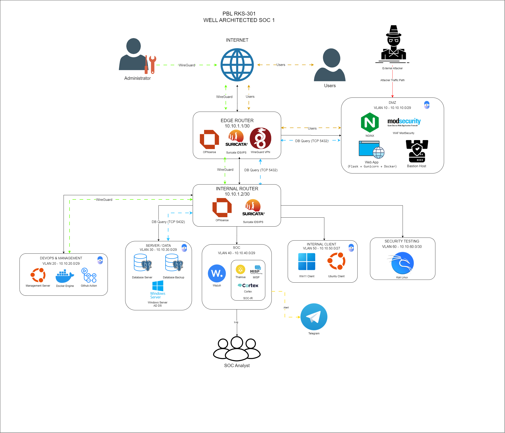

# Topologi dari RPP

**Versi:** 0.6 - 18 Oktober 2026  
**Sumber gambar:** RPP PBL RKS-301 perbaikan.docx, bagian Desain Umum.  
**Status:** gambar acuan RPP, bukan bukti konfigurasi atau pengujian lab.

Gambar dipakai apa adanya dari dokumen RPP yang tersedia pada sumber proyek. Ukuran asli 1287 x 1104 piksel; tulisan, ikon dan koneksi pada gambar tidak diubah. Gambar ini menggantikan diagram buatan paket sebelumnya.

## Perbedaan dengan daftar VM terkini

Gambar RPP yang tersedia belum menampilkan Bastion Host 10.10.10.3 secara terpisah. Tabel pada RPP perbaikan masih menyebut 12 VM, sementara arahan tugas terbaru dan konfirmasi pengguna memakai 13 VM termasuk Bastion. Karena pengguna meminta gambar RPP, gambar tetap dipertahankan dan perbedaan ini dicatat.

Daftar 13 VM dan IP target terkini tetap mengikuti [tabel IP/VLSM](tabel-ip-vlsm.md). Gambar tidak dipakai untuk menyatakan seluruh 13 VM sudah tergambar atau seluruh jalur telah diuji. Alur, label IDS/IPS dan penempatan panah pada gambar merupakan isi sumber RPP; target keamanan tim yang dipilih adalah IPS sesuai [rencana IPS](rencana-ips-opnsense.md).

File RPP Final asli belum tersedia pada sumber lokal. Bila gambar Final yang disahkan berbeda, cocokkan sumber itu sebelum pengesahan dokumen. File RPP pada folder sumber tidak diubah.

## Identitas sumber

| Item | Nilai |
| --- | --- |
| Dokumen sumber lokal | RPP PBL RKS-301 perbaikan.docx |
| Bagian / media di dalam dokumen | Desain Umum / word/media/image1.png |
| Berkas gambar paket | topologi-rpp.png |
| Dimensi asli | 1287 x 1104 piksel |
| SHA-256 gambar | `dd5bb08975446a21acc050ceb0d4ba5c0cd8657501a108ee469b231a3d098b2a` |
| SHA-256 dokumen sumber lokal | `5a9cb375e84a741646bf0e029bdaeeaa3cf6b803e60209af26c0d900ad5a993f` |

Catatan teknis ekstraksi dan pemeriksaan tercantum pada [validasi paket](../../evidence/network/validasi-paket.md).
